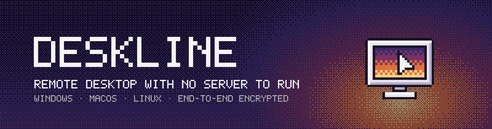
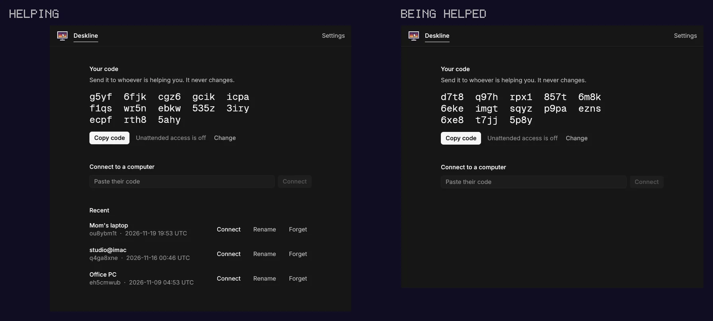
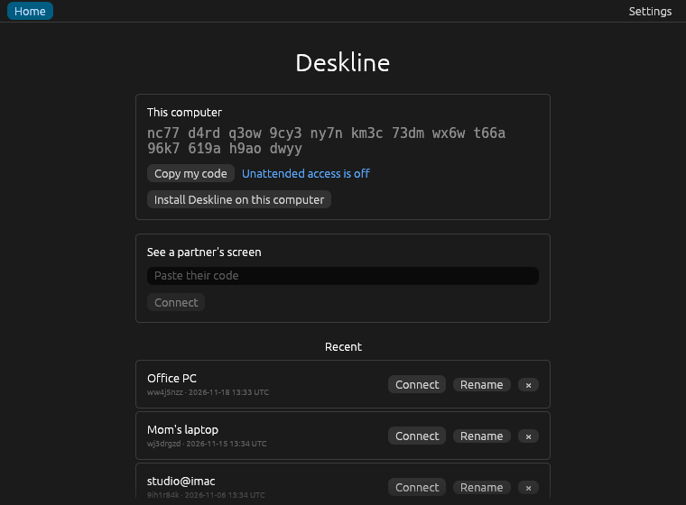
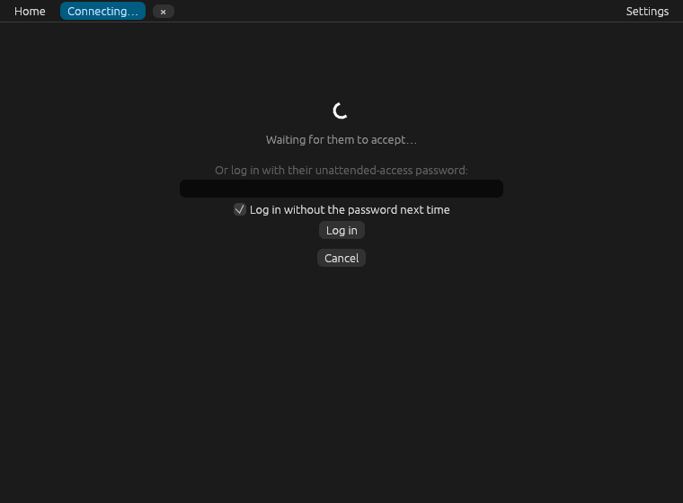
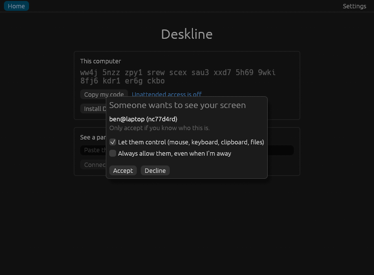
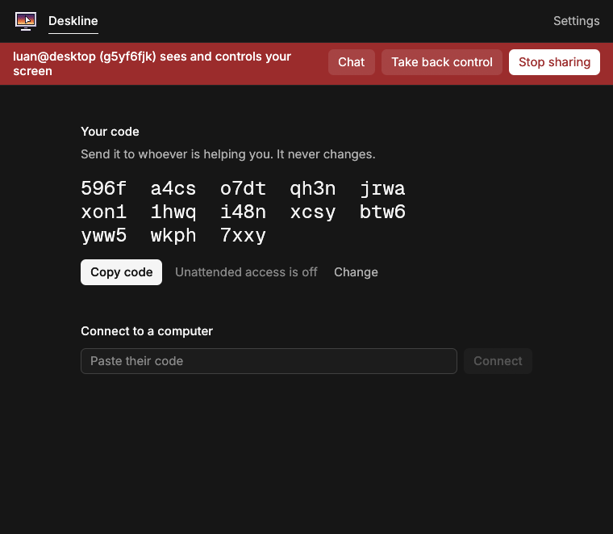
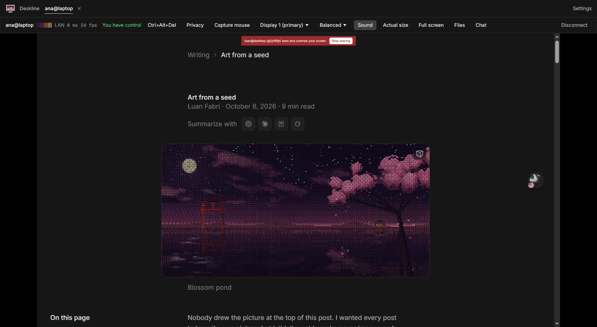

<p align="center">
  <picture>
    <source media="(prefers-reduced-motion: reduce)" srcset="assets/banner.png">
    
  </picture>
</p>

<p align="center">
  <a href="https://deskline.luannzin.com"><b>Download</b></a> ·
  <a href="#coming-from-anydesk">Coming from AnyDesk</a> ·
  <a href="#build">Build</a>
</p>

Deskline is remote desktop with no server for you to run. Every computer has a code. Paste
someone's code, they accept, and you see their screen; with their OK you drive their mouse and
keyboard, copy and paste between the two computers, move files, and hear their sound. It works on
the same network or across the internet, and traffic is encrypted end to end either way.

I started it as the smallest thing that could replace AnyDesk when I help family and friends. Then
it needed the rest of what makes AnyDesk usable day to day: getting into your own computer when
nobody is in front of it, the sign-in screen, the address book, a picture that stays usable on a
bad connection. That's all in now.

<p align="center">
  <picture>
    <source media="(prefers-reduced-motion: reduce)" srcset="docs/demo.png">
    
  </picture>
  <br>
  <sub>Two copies of Deskline 0.8.0 on one computer, recorded as they connected.</sub>
</p>

## Install

Grab the file for your system from [Releases](https://github.com/luannzin/deskline/releases/latest).

| System | File | |
|---|---|---|
| Windows 10/11 | `deskline.exe` | One file. Run it as is, or install it for everyone, with its service, from **Settings → Install for all users** (see below). |
| Ubuntu 24.04+ / Debian 12+ | `deskline_amd64.deb` | `sudo apt install ./deskline_amd64.deb` |
| Linux, portable | `deskline-linux-x86_64` | No install: `chmod +x deskline-linux-x86_64` and run it. Needs PipeWire, GStreamer and a desktop session. |
| macOS 11+ | `Deskline.dmg` | Drag Deskline into Applications. Allow it under **System Settings → Privacy & Security → Screen Recording** and **Accessibility** when it asks. |
| macOS, portable | `Deskline-macos.zip` | No install: unzip and open `Deskline.app` from anywhere. Same permissions as above. |

The builds aren't signed with a paid certificate yet, so Windows SmartScreen says **More info →
Run anyway** and macOS wants **Open Anyway** the first time.

Deskline updates itself from Releases: the window offers **Restart to update** when a new version
is downloaded, and the installed Windows service updates on its own.

## Use it

1. Both people open Deskline.
2. The person who needs help clicks **Copy code** and sends it.
3. The other pastes it under **Connect to a computer** and clicks **Connect**.
4. The first person gets the prompt below and clicks **Accept**. "Let them control" is ticked by
   default, the way AnyDesk's accept window is; untick it for view only.
5. While a session runs the person sharing sees a red bar with **Chat**, **Take back control** and
   **Stop sharing**.

What the person helping sees:

<p align="center">
  
  
</p>

What the person being helped sees:

<p align="center">
  
  
</p>

The viewer's toolbar has everything else: **Ctrl+Alt+Del**, **Privacy** (blanks their screen and
locks their own mouse and keyboard), the monitor picker, picture quality, sound, actual size, full
screen (F11 to leave), **Files** and **Chat**. On Windows every key goes through, Win, Alt+Tab and
Print Screen included.

<p align="center">
  
</p>

**Files** browses their computer: the folders along the way open with a click, Home, Desktop,
Documents and Downloads are one click from anywhere, and Find narrows a long folder. A double
click (or Enter) downloads a file into your Downloads. Send files, or drop them on the window, and
they land in the folder you're looking at (their Downloads when none is open). Each transfer shows
its progress, can be cancelled, and once it's here, shown in its folder.

Copy on one computer and paste on the other while you have control: text, and files too. Copy files
here and press Ctrl+V on their screen, and they go over and paste where you are there. Copy files
there, and they come to your clipboard on their own, ready to paste here (past 256 MB, you're asked
first).

For games and video, pick **Native (games)**: their screen at its own size (up to 4K) and its own
frame rate (as fast as it refreshes, up to 240), with more bits per frame than Sharp text. It never
gets smaller: when the link or the computer can't keep up, fewer frames come instead. **Capture mouse**
hands your mouse's raw movement to their computer, the way games that hide the pointer read it;
**Ctrl+Alt+Shift+Z** gives it back. The toolbar shows the frames a second you're getting.

On Linux the system's own sharing dialog decides which screens are shared and whether the viewer
may control them. That answer can change later. The monitor picker's **Other screens…** asks the
person sharing, and the dialog opens when they click **Choose screens** (it's on their red bar too).
Giving control when remote interaction was left off brings the dialog back by itself.

Each session gets a tab, so you can have several screens open, and several people can watch the
same screen.

## Unattended access

For your own computers, or anyone who's fine with you getting in without a click:

- **Settings → Unattended access → Set password.** Anyone with the password connects and gets
  control straight away. The password is stored as an Argon2 hash. Five wrong tries lock that
  caller out for five minutes, and thirty from anyone lock everyone out for a while.
- When the viewer types the password, **Log in without the password next time** puts them in
  **Always allowed**. The accept prompt has the same tick box. Remove people there whenever you
  want.
- If the link drops, the viewer reconnects on its own and gets straight back in for 90 seconds.
- Every session is written to `sessions.log` next to the settings: who, how they got in, for how
  long, and what files went where.

### Installed mode on Windows

**Settings → Install for all users** (one UAC prompt) copies Deskline to
`C:\Program Files\Deskline` and installs a Windows service. That's what makes it a real AnyDesk
replacement for remote support:

- It starts with Windows, before anyone signs in, so the sign-in screen, the lock screen and UAC
  prompts can be seen and clicked, and **Ctrl+Alt+Del** works.
- The computer keeps the same code for every user, stored in `%ProgramData%\Deskline` where only
  administrators can read it.
- Closing the window doesn't stop anything. When someone asks to connect, the window opens for the
  person signed in.
- Changing the unattended-access password needs an administrator (**Change as administrator**).
- Uninstall from **Settings** or from Windows' **Apps & features**. The code is kept, so
  installing again doesn't change it.

On Linux and macOS, **Start Deskline when I sign in** keeps it reachable from the tray.

## Coming from AnyDesk

| AnyDesk | Deskline |
|---|---|
| 9-digit address | A 52-character code you copy and paste, saved in **Recent** under a name you choose (**Rename**). There's no central server handing out short numbers, which is the point. |
| Accept window with permissions | Same, with **Let them control** and **Always allow them** |
| Unattended access password | **Settings → Unattended access** |
| "Install AnyDesk" | **Settings → Install for all users** |
| Address book | **Recent**, with names |
| File manager / clipboard files | **Files** panel to browse, download and send into any folder; copy files on one computer and paste them on the other |
| Privacy mode, block input | **Privacy** (Windows 10 2004+) |
| Ctrl+Alt+Del, switch monitor, quality | In the toolbar |
| Chat | **Chat** on both sides |
| Sound | On by default, **Sound** to mute |
| `anydesk ID --with-password` | `echo pw \| deskline CODE --with-password` |
| AnyDesk On-Premises | Run your own [iroh-relay](https://github.com/n0-computer/iroh) and set it under **Settings → Relay server** |

Not there yet: session recording, Wake-on-LAN, TCP tunnels, and phone apps.

## Security

- The code is the computer's public key. A connection is QUIC with TLS keyed to that key, so you
  reach the computer whose code you pasted and nobody in between can read or change the session,
  the relays included.
- Nothing about your sessions goes to a server you don't run. n0's public relays help two
  computers find each other and carry the encrypted traffic when there's no direct path.
- A session never starts without a click on Accept, the unattended-access password, or your own
  "Always allow". Control, clipboard and files need control; viewing alone gets none of them.
- Received names are cleaned before anything is written, so a file can't land outside Downloads.
  On an installed computer the viewer's file access runs as the signed-in user, never as SYSTEM.
- The installed service only talks to windows on the same computer, over a pipe that only
  interactive users can open, and changes to who gets in without a click need an administrator.

## Build

```bash
# Linux (Debian 12+ / Ubuntu 24.04+: PipeWire 0.3.65+ headers): libclang (bindings), nasm
# (fast encoder), sound and display headers
tools/install-linux-deps.sh
cargo build --release            # target/release/deskline

# Windows (MSVC): install nasm for the fast encoder
cargo build --release            # target\release\deskline.exe

# Windows .exe from Linux (no DLLs needed next to it)
sudo apt install mingw-w64
rustup target add x86_64-pc-windows-gnu
CARGO_TARGET_X86_64_PC_WINDOWS_GNU_RUSTFLAGS="-C target-feature=+crt-static -L /usr/lib/gcc/x86_64-w64-mingw32/13-posix" \
  cargo build --release --target x86_64-pc-windows-gnu

# macOS: a universal .app and .dmg in dist/
tools/build-macos.sh
```

The installers come from `tools/build-windows.sh`, `tools/build-deb.sh` and `tools/build-macos.sh`.
Bumping `version` in `Cargo.toml` and pushing to `main` builds all three in GitHub Actions and
publishes the release, which installed copies then update to. `tools/logo.py` draws the pixel-art mark,
the icons and the banner.

Run two copies on one machine with `--home DIR` (each folder is its own identity).

## Tests

```bash
cargo test                                         # codec, sound, files, settings, keys, protocol
cargo test two_peers -- --ignored                  # two real endpoints: decline, accept, control,
                                                   # monitors, chat, revoke, stop, passwords, trust
cargo test --release encode_speed -- --ignored --nocapture   # ms per 1080p frame
cargo test loopback -- --ignored --nocapture       # Windows: captures what a tone plays
```

## How it works

- `src/net.rs`: [iroh](https://github.com/n0-computer/iroh) QUIC dialed by public key (hole
  punching, relay fallback, mDNS on the LAN), with the identity saved on disk.
- `src/proto.rs`: the wire. The viewer opens a control stream, the host a video stream; sound goes
  in datagrams. Unknown messages are skipped, so versions don't have to match.
- `src/host.rs`, `src/viewer.rs`: both ends of a session. Frames are acked and as many may be in
  flight as fill one round trip; when acks hold the sender back, the encoder is asked for fewer
  bits, and for more once the link is calm.
- `src/codec.rs`: H.264 with OpenH264 compiled in, or the GPU's encoder when there is one, sized
  and paced by the quality setting: 30 fps for desktops, the screen's own rate for Native. On Windows (Media
  Foundation) the picture goes from capture to encoder without leaving the GPU; on Linux
  (GStreamer: NVENC, or VA-API on Intel and AMD) the GPU scales and converts it. A picture that
  goes still is encoded again a few times so text blurred by motion sharpens.
- `src/audio.rs`: what the speakers play, as Opus.
- `src/files.rs`, `src/clip.rs`: file transfer and clipboard.
- `src/desktop/`: capture and input. Windows: DXGI duplication and `SendInput`, following the
  secure desktop when installed. Linux: the RemoteDesktop portal (GNOME, KDE), wlroots (Sway,
  Hyprland) or X11 (XFCE, Cinnamon, MATE…). macOS: CoreGraphics display streams and CGEvent.
- `src/service.rs`, `src/ipc.rs`: Windows installed mode and the pipe between the service and the
  window.
- `src/ui.rs`: the egui window. `src/settings.rs`: password, trusted people, address book, log.

## Known limits

- Linux can't share the sign-in screen, and privacy mode is Windows-only.
- Native at high frame rates needs a GPU encoder on the shared computer and a fast CPU on the
  viewing one: macOS encodes in software, Linux needs GStreamer's GPU encoders
  (`gstreamer1.0-plugins-bad` or `gstreamer1.0-vaapi`), and every viewer decodes in software, so
  without them Native keeps the size and sends fewer frames.
- Sharing sound from a Mac needs macOS 14.6+ or a loopback device such as BlackHole.
- On a Mac the permissions are tied to the app's signature: an unsigned build asks again after
  each update.
- I wrote the Linux and macOS backends in this version without a Linux or Mac machine to try them
  on. Expect rough edges there, and please open an issue when you hit one.
